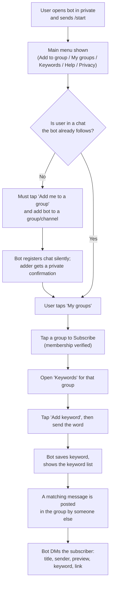

# Huntzz — User Flow Audit

A read-only walkthrough of what the Huntzz Telegram bot actually does, written from
the point of view of someone who has never seen it before. Every statement below is
derived from the source in `bot.js`, `schema.sql`, the `migrations/` scripts and
`README.md`. Where a behavior depends on Telegram's servers (privacy mode, chat
membership, deep-link opening) it is marked **UNVERIFIED**.

---

## 1. OVERVIEW

Huntzz is a Telegram bot that **privately alerts a member when a message they care
about is posted in a group or channel they follow**. A member picks keywords per
chat; when a posted message contains a keyword (whole word / phrase, case
insensitive) Huntzz sends that member a direct message with a preview and — when a
link can be built — a link back to the original message.

Key facts:

- Runs on **long polling** (no web server / webhook). `bot.start({ allowed_updates: ["message", "channel_post", "my_chat_member", "callback_query"] })`.
- Single file: `bot.js` (Node.js ESM, grammY 1.46, Supabase).
- Storage: Supabase Postgres. Users, groups, subscriptions, keywords and pending
  input are stored; **message text is never stored**.
- The bot only acts in **private chats** for commands and menus. In groups/channels
  it is a passive reader (it never replies in a group).
- There is **no role system**: any user can add the bot, any member can subscribe,
  there is no "owner" concept in the code.

### Brand-new user journey (high level)



---

## 2. ACTORS AND ROLES

| Actor                                                           | How they appear in code                                                                                   | What they can do                                                     |
| --------------------------------------------------------------- | --------------------------------------------------------------------------------------------------------- | -------------------------------------------------------------------- |
| **Chat adder** (`my_chat_member.from`)                          | The account that adds the bot to a group/channel. Stored as `groups.added_by` and upserted into `users`.  | Gets a private confirmation DM. Otherwise no special powers.         |
| **Member / subscriber** (any user who opens the bot in private) | Rows in `users`, `subscriptions`, `keywords`, `pending_input`.                                            | Subscribe/unsubscribe per chat, add/remove keywords, receive alerts. |
| **Non-subscriber member**                                       | Upserted into `users` on any private interaction; may also be created when they add the bot or subscribe. | Nothing until they subscribe. Still stored.                          |
| **Group/channel admin**                                         | Not stored as such — only detected live via `getChatAdministrators` (cached 10 min) for the ad filter.    | Exempt from "drop"-mode ad filtering.                                |
| **Channel**                                                     | `groups.type = "channel"`.                                                                                | Treated as always-admin for the ad filter; sender name unavailable.  |
| **The bot itself**                                              | `ctx.me.id`.                                                                                              | Ignored by the matcher (won't alert on its own messages).            |
| **The operator/developer**                                      | Owns the token, Supabase project and the single running process.                                          | Configures env vars, runs migrations, deploys.                       |

There is **no ownership model**: `groups.added_by` is recorded but never re-checked.
Any member of a registered chat may subscribe to it (subject to a live
`getChatMember` check). Any user may add the bot to any chat they administer.

---

## 3. SETUP (what a brand-new user experiences)

There is no onboarding outside Telegram. A brand-new user must first **already have
the bot added to a group they belong to** (or add it themselves). The steps:

1. **Open the bot in private and send `/start`.**
   - The user is upserted into `users` (`blocked` reset to `false`).
   - The **main menu** is always shown:
     > `Hi! I help you catch the messages that matter in your Telegram groups.`
     >
     > `Add me to a group to get started.`
   - Buttons: `➕ Add me to a group` (URL), `👥 My groups` (`my_groups`), `🔑 Keywords`
     (`keywords_menu`), `❓ Help` (`help_menu`), `🔒 Privacy` (`privacy_menu`).
   - If this is the **first time** the bot has seen this user (`upsertUser` returns
     `true`), a second message is sent immediately: the full **HELP_TEXT** guide (see
     §8 for the verbatim text).
2. If the user is not in any chat the bot follows, the menu is a dead end until the
   bot is added to a group. **My groups** then shows:
   > `I'm not registered in any group yet. Add me to one to get started.`
   > plus the `➕ Add me to a group` button.
3. Otherwise the user proceeds to **§5 Subscribing**.

Operator-side setup (for completeness, from `README.md`): create the bot with
`@BotFather` and **disable privacy mode** (`/setprivacy` → Disable) so it can read
normal group messages; create a Supabase project and run `schema.sql` →
`migrations/001` → `002` → `003` in order; copy `.env.example` to `.env`; `npm install`
and `npm start` (Node ≥ 20). Whether privacy mode was actually disabled and whether
the migrations were actually applied to the live database are **UNVERIFIED** from the
code.

Env vars the process requires/reads: `BOT_TOKEN` (required, else exits), `SUPABASE_URL`

- `SUPABASE_KEY` (required, else exits), `DEBUG` (`"true"` enables text logging,
  default off), `AD_FILTER_MODE` (`off` | `log` | `drop`, default `log`).

---

## 4. ADDING TO A GROUP OR CHANNEL

The only registration path is Telegram's `my_chat_member` update.

1. The adder adds the bot. Telegram sends a `my_chat_member` update with
   `new_chat_member.status` of `member` or `administrator` (privileged users are
   stored as `administrator`).
2. Huntzz **registers the chat silently** — there is **no message posted into the
   group**. It:
   - upserts the **adder** into `users`;
   - looks for an existing `groups` row for that `chat_id`;
   - **first time**: inserts/upserts `groups` (`chat_id`, `title`, `type`, `added_by`,
     `active: true`), then sends the adder a private DM:
     > `✅ "<title>" is now registered.`
   - **previously seen** (e.g. the bot was removed and re-added): sets
     `groups.active = true` and DMs the adder:
     > `"<title>" is already registered. Open me here and subscribe to it from My groups.`
   - In both cases the per-chat matcher cache is invalidated first.
3. If the bot is removed (`status = left` or `kicked`), the chat's row is set
   `groups.active = false`. No message is sent. **Keywords and subscriptions are kept**
   on the rows, but matching stops for that chat (the RPC requires `g.active`).
4. Registration **does not subscribe the adder**. The adder must still open the bot
   and tap the chat under **My groups** to receive alerts.

Channel caveat: to read channel posts, the bot must be an **administrator** of the
channel — this is documented in the README but is a Telegram-side requirement and is
**UNVERIFIED** from the code.

---

## 5. SUBSCRIBING

Entry points: the `👥 My groups` button (`my_groups`), reachable from the main menu.

**My groups** (`groupsView`) lists **every active known group** (all rows in
`groups` where `active = true`, regardless of the user's membership):

- Each row is prefixed `✅` if the user is subscribed (active subscription), `▫️` if
  not.
- One button per group: `✅ <title>` (`sub:<chatId>`) when subscribed, `➕ <title>`
  when not.
- If there are **no active groups at all**, it shows the "not registered in any group"
  text + the add-to-group button.

Tapping a group button (`sub:<chatId>`):

1. Huntzz calls `getChatMember(chatId, userId)`.
   - On API error → toast `I couldn't verify your membership in that group.` and stop.
   - If status is `left` or `kicked` → toast `You're not a member of that group anymore.` and stop.
2. Otherwise it looks up the user's existing subscription row:
   - **Active** → soft-unsubscribe: `subscriptions.active = false`; toast `Unsubscribed.`
     (keywords are kept).
   - **Inactive** (previously soft-unsubscribed) → `active = true`; toast `Subscribed ✅`.
     **No limit check** on reactivation.
   - **Absent** → counted; if the user already has `MAX_SUBSCRIPTIONS` (50) active
     subscriptions → toast `You can follow at most 50 groups. Unsubscribe from one first.`
     and stop. Otherwise the user is upserted and a row is created (`active: true`) via
     upsert on `(user_id, chat_id)`; on error → toast `Couldn't save the subscription.`
     else toast `Subscribed ✅`.
3. The chat's matcher cache is invalidated and the **My groups** view is re-rendered.

Notes:

- A user may subscribe to a chat **even without that check being definitive** if the
  Telegram call succeeds but the user later leaves — the check is point-in-time only.
- The **50-subscription cap counts active subscriptions only**.

---

## 6. KEYWORDS

Entry points: the `🔑 Keywords` button (`keywords_menu`) or `/keywords`.

**Keywords menu** (`keywordsMenuView`) lists the user's categories by group:

- It joins `subscriptions` → `groups` and keeps only rows where the **subscription is
  active** _and_ the **group is active**.
- If none → text `You're not subscribed to any group yet. Open My groups and subscribe first.`
  with a `👥 My groups` button.
- Otherwise one button per subscription: `🔑 <title>` (`kw:<chatId>`).

Tapping a group (`kw:<chatId>`) → **Keywords view** (`keywordsView`):

- Requires an **active** subscription for `(user, chat)`; otherwise text
  `You're not subscribed to that group anymore.` with a `⬅️ Back` button.
- Shows the user's keywords for that chat, ordered by keyword, as buttons
  `🗑 <keyword>` (`delkw:<chatId>:<id>`) — one per row, i.e. tapping removes it.
- Body text:
  > `Keywords for "<title>" — tap a keyword to remove it.`
  > `You'll get a DM when a message in this group contains one of them.`
  >
  > `• <kw>` … or `No keywords yet.`
- Buttons: `➕ Add keyword` (`addkw:<chatId>`) and `⬅️ Back` (`keywords_menu`).

### Adding a keyword

1. Tapping `➕ Add keyword` (`addkw:<chatId>`):
   - Re-checks for an **active** subscription; if none → toast
     `You're not subscribed to that group.` and stop.
   - Stores a **pending input** row: `pending_input(user_id, action="add_keyword", chat_id, created_at)`.
   - Toast: `Send me the keyword now.`
   - Reply: `Send me the keyword to watch for in this group (e.g. "job"). Send /cancel to stop.`
2. The user sends a **plain text message** in private. Processing:
   - Any command (`/…`) in private **clears the pending input first** (global middleware),
     then normal command handling applies. So typing any command cancels keyword entry.
   - Otherwise Huntzz loads the pending row. If absent, expired (> 10 min), or a
     different action → the message is **silently ignored**.
   - The pending row is cleared immediately.
   - Text is **normalized**: trimmed, internal whitespace collapsed to single spaces,
     lower-cased, then **truncated to 40 characters** (`MAX_KEYWORD_LENGTH`).
   - Validation (`keywordError`):
     - empty → `That looks empty — send a word or phrase to watch for.`
     - no letter/digit (punctuation only) → `A keyword needs at least one letter or number (punctuation alone won't work).`
     - On failure: reply `<problem> Send another one, or /cancel.` (note: the pending
       row was already cleared, so the user must tap **Add keyword** again — **UNVERIFIED**
       UX gap, see §13).
   - Per-group cap: if the keyword is **new** and the user already has
     `MAX_KEYWORDS_PER_GROUP` (20) keywords in that chat → reply
     `You've reached the limit of 20 keywords for this group. Remove one first.`
     Re-saving an already-saved keyword is always allowed.
   - Saved via upsert on `(user_id, chat_id, keyword)`; cache invalidated.
   - Reply: `✅ Watching for "<kw>".` plus ` (trimmed to 40 characters)` if truncated,
     or `Couldn't save the keyword: <message>` on error.
   - The **Keywords view** is sent as a second message.

### Removing a keyword

Tapping `🗑 <keyword>` (`delkw:<chatId>:<id>`) deletes the row **by keyword id AND
user_id** (so a user can only delete their own), invalidates the cache, toasts
`Removed.`, and re-renders the Keywords view. (If the edit fails, the error is
swallowed — the old message stays.)

### `/cancel`

`clearPending(userId)` always runs. If the chat is private, replies
`Cancelled — no keyword added.` In a group it silently clears (no reply).

### `/unsubscribeall`

- Counts active subscriptions. If none → `You're not subscribed to any groups.`
- Else asks: `Unsubscribe from all <count> groups? Your keywords are kept.` with
  buttons `✅ Yes, unsubscribe from <count>` (`unsuball_confirm`) and `✖️ Cancel`
  (`unsuball_cancel`).
- Confirm → sets every active subscription `active = false`, invalidates each chat's
  cache, toast `Unsubscribed from all.`, edits text to
  `Done — you're no longer subscribed to any groups. Your keywords are saved for when you come back.`
- Cancel → toast `Cancelled.`, edits text to `Okay, nothing changed.`

---

## 7. MATCHING AND ALERTS

Triggered per incoming **new** group/supergroup message and per **new** channel post.
(`edited_message` is **not** in `allowed_updates`, so edits never trigger a match.)

### What text is examined

- Group/supergroup: `message.text ?? message.caption` (captions are matched).
- Channel post: `channelPost.text ?? channelPost.caption`.
- The bot's own messages are skipped (`ctx.from?.id === ctx.me.id`).
- Empty text (e.g. pure media with no caption) → nothing happens.

### Matching algorithm

1. `getChatMatchers(chatId)` runs the RPC `chat_matchers(p_chat_id)` and caches the
   result for `CHAT_CACHE_TTL_MS` (45 s) per chat. The RPC returns `(user_id, keyword)`
   for all subscribers where `s.active AND g.active AND NOT u.blocked`.
2. For each subscriber, each keyword is compiled to a **whole-word/phrase** regex:
   `(?<![\p{L}\p{N}])<escaped keyword, spaces → \s+>(?![\p{L}\p{N}])` with flags `iu`
   (case-insensitive, Unicode). This means a keyword only matches when it is **not
   adjacent to another letter or digit**.
3. The **sender is never alerted about their own message**. (Matching is per user; the
   sender's own subscription is skipped even if their keyword matches.)
4. A subscriber gets **one** alert listing **all** keywords that matched.

### Ad filter (runs before matching)

`AD_PATTERNS` (in `bot.js`, tunable) match: `t.me/+` invite links, `t.me/joinchat`,
`join (our|my|the) (channel|group)`, `subscribe (to|now)`, `click (the )?link`.

- `AD_FILTER_MODE = off` → never filters.
- `log` (default) → never drops; logs only when `DEBUG=true`.
- `drop` → drops the alert if the text looks like an ad, **except** when the sender is
  a chat admin. Admin ids are fetched via `getChatAdministrators` and cached 10 min
  (`ADMIN_CACHE_TTL_MS`). Channel posts are always treated as admin. If the admin
  lookup fails, the sender is treated as **non-admin** (fails safe toward dropping).

### Alert format (HTML)

Each alerted user receives one message:

```
🔔 <b>{chat.title}</b>
{senderName}: {preview}          ← senderName omitted for channel posts
                                 ← blank line →
Keyword: {comma-separated matched keywords}
<a href="{link}">Open message</a>   ← only when a link exists
```

- `chat.title`, `senderName`, preview and keywords are **HTML-escaped** (`&`, `<`, `>`).
- Preview is the message text, **truncated to 300 characters** with `…` when longer.
- Sender name for groups is `first_name + " " + last_name` (or `?` if neither);
  channel posts have no sender name.
- Link: `https://t.me/<username>/<messageId>` when the chat has a public username;
  otherwise `https://t.me/c/<id-without-”-100”>/<messageId>` for **supergroups and
  channels**; **`null` for plain `group` chats** (no link line is added).

### Delivery and blocking

- Sends are **sequential** (one `await` per user), wrapped by `autoRetry()` (retries
  on Telegram 429) and `apiThrottler()` (spaces out bulk sends).
- If a send fails with **error_code 403** (user blocked the bot / deactivated), the
  user's `users.blocked` is set `true` and a console error is logged. That user is
  then excluded from matching until they message the bot again (any private interaction
  that calls `upsertUser` resets `blocked = false`).
- Any other send error is logged **without** the message text.

---

## 8. EVERY COMMAND AND BUTTON

### Commands (all are no-ops outside private chats — the handlers return early)

| Command           | Where   | Effect                                                            |
| ----------------- | ------- | ----------------------------------------------------------------- |
| `/start`          | private | Upserts user; shows main menu; first-timers also get `HELP_TEXT`. |
| `/help`           | private | Upserts user; shows `HELP_TEXT` + `⬅️ Back`.                      |
| `/privacy`        | private | Upserts user; shows `PRIVACY_TEXT` + `⬅️ Back`.                   |
| `/keywords`       | private | Upserts user; shows Keywords menu (group list).                   |
| `/unsubscribeall` | private | Confirm flow to deactivate all subscriptions (keywords kept).     |
| `/pause [hours]`  | private | Pause alerts for 1 to 720 hours.                                  |
| `/resume`         | private | Clear the user's pause.                                           |
| `/quiet HH HH`    | private | Set timezone-aware quiet hours.                                   |
| `/quietoff`       | private | Clear quiet hours.                                                |
| `/deleteme`       | private | Confirm and permanently delete the user's data.                   |
| `/cancel`         | any     | Clears pending input; replies only in private.                    |

Note: the audit brief mentioned a `/mygroups` command — **there is no `/mygroups`
command in the code.** "My groups" exists only as the `👥 My groups` button
(`my_groups` callback). `/start`, `/help`, etc. typed inside a group produce **no
response** (silently ignored).

### Callback buttons

| Button label (exact)                 | Callback data                                     | What it does                                           |
| ------------------------------------ | ------------------------------------------------- | ------------------------------------------------------ |
| `➕ Add me to a group`               | URL `https://t.me/<bot_username>?startgroup=true` | Opens Telegram's add-to-group picker.                  |
| `👥 My groups`                       | `my_groups`                                       | Renders My groups.                                     |
| `🔑 Keywords`                        | `keywords_menu`                                   | Renders Keywords menu.                                 |
| `❓ Help`                            | `help_menu`                                       | Edits message to `HELP_TEXT` + Back.                   |
| `🔒 Privacy`                         | `privacy_menu`                                    | Edits message to `PRIVACY_TEXT` + Back.                |
| `⬅️ Back`                            | `start_menu`                                      | Edits back to the main menu.                           |
| `✅ <title>` / `➕ <title>`          | `sub:<chatId>`                                    | Subscribe / unsubscribe (with membership check).       |
| `🔑 <title>`                         | `kw:<chatId>`                                     | Open Keywords for that group.                          |
| `🗑 <keyword>`                       | `delkw:<chatId>:<id>`                             | Delete that keyword.                                   |
| `➕ Add keyword`                     | `addkw:<chatId>`                                  | Start keyword entry (sets pending input).              |
| `📢 Admin posts: on/off`             | `adminposts:<chatId>`                             | Toggle alerts for admin posts without keyword matches. |
| `🧰 Starter packs`                   | `packs:<chatId>`                                  | Show built-in keyword packs.                           |
| Starter pack                         | `pack:<chatId>:<name>`                            | Add pack words, respecting the 20-word limit.          |
| `👥 My groups` (empty-keywords view) | `my_groups`                                       | Same as above.                                         |
| `✅ Yes, unsubscribe from <n>`       | `unsuball_confirm`                                | Deactivate all subscriptions.                          |
| `✖️ Cancel`                          | `unsuball_cancel`                                 | Cancel unsubscribe-all.                                |

Callback handlers answer the query (removing the loading spinner) and, on any
`editMessageText` failure, fall back to sending a new message. All `answerCallbackQuery`
calls are wrapped in `.catch(() => {})` so a stale tap never throws.

### Verbatim onboarding texts

`HELP_TEXT`:

```
Huntzz alerts you when a message you care about is posted in a group or channel you follow.

How it works
• Add me to a group or channel.
• Subscribe to it from “My groups”.
• Add keywords for it from “Keywords”.
• I DM you when a message matches.

Commands
/start — main menu
/help — this guide
/privacy — how your data is handled
/keywords — manage keywords per group
/unsubscribeall — stop following every group
/pause [hours] — pause alerts
/resume — resume alerts
/quiet HH HH — set quiet hours
/quietoff — clear quiet hours
/deleteme — delete my data
/cancel — cancel a pending keyword

Setup so you never miss an alert
1. Mute noisy groups — or put them in a folder and mute the folder — so their pings don’t bury my alerts.
2. Open the Huntzz chat, tap its name, go to Notifications, and pick a distinct sound. (Menu names differ slightly between Android and iOS.)
3. Pin the Huntzz chat so alerts stay on top.
```

`PRIVACY_TEXT`:

```
Privacy

• I read messages only in groups and channels where I’ve been added, and only to check them against members’ keywords.
• I do not store message text — messages are scanned in memory and then discarded.
• I store user ids, group/channel ids, and the keywords you set.
• Any group admin can remove me from a group at any time; that stops all reading there.

Questions? Message me here anytime.
```

---

## 9. CAN / CANNOT

### The bot CAN

- Register a group/channel silently when added, and record who added it.
- Let any member subscribe to any active registered chat (after a live membership check).
- Respect a per-group keyword cap (20) and a per-user subscription cap (50).
- Match whole words/phrases, case-insensitively, across letters and numbers in any
  script, and match captions.
- Send one DM per matching user, listing every matched keyword, with an HTML-escaped
  preview (≤ 300 chars) and a link when it can build one.
- Optionally alert subscribers about admin posts even when no keyword matches, and offer
  starter keyword packs.
- Keep alerts in a seven-day inbox and suppress duplicate recipient/message rows.
- Pause delivery temporarily or during timezone-aware quiet hours without losing inbox rows.
- Let users permanently delete their account data with `/deleteme`.
- Keep keywords across unsubscribe, and reactivate a subscription instantly.
- Pause alerts for users who blocked it (403) and resume when they message again.
- Skip edited messages, its own messages, and messages with no text/caption.
- Survive a bad update (`bot.catch`) and shut down cleanly on `SIGINT`/`SIGTERM`.

### The bot CANNOT

- Reply inside a group/channel (all commands and menus are private-only).
- Alert a user about **their own** message, even if it matches their keyword.
- Provide an "Open message" link for messages in **plain (non-super) groups**.
- Detect membership changes over time — the `getChatMember` check is point-in-time.
- Recover a pending keyword entry that expired (> 10 min) — the message is silently dropped.
- Alert on edits to already-posted messages (only brand-new messages are processed).
- Tell a user "the bot isn't in this group" beyond the "not registered"/membership toasts.
- Store or show back message text (by design). It also stores no message history.
- Enforce who may register a chat — any admin of any chat can add it.

---

## 10. DATA STORED PER STEP

| Step                                                         | Table / column written                                           | Notes                                                                |
| ------------------------------------------------------------ | ---------------------------------------------------------------- | -------------------------------------------------------------------- |
| Any private interaction (`/start`, `/help`, subscribe, etc.) | `users` (`user_id`, `username`, `first_name`, `blocked=false`)   | Upsert; `blocked` is reset on every interaction.                     |
| Bot added to a chat (first time)                             | `groups` (`chat_id`, `title`, `type`, `added_by`, `active=true`) | Also upserts the adder into `users`.                                 |
| Bot re-added to a known chat                                 | `groups.active = true`                                           | Title/type/added_by not refreshed.                                   |
| Bot removed / kicked                                         | `groups.active = false`                                          | Row, keywords and subscriptions retained.                            |
| Subscribe (new)                                              | `subscriptions` (`user_id`, `chat_id`, `active=true`)            | Upsert on `(user_id, chat_id)`.                                      |
| Unsubscribe                                                  | `subscriptions.active = false`                                   | Soft — keywords retained.                                            |
| Re-subscribe                                                 | `subscriptions.active = true`                                    | No limit check.                                                      |
| Tap "Add keyword"                                            | `pending_input` (`user_id`, `action`, `chat_id`, `created_at`)   | Upsert on `user_id`; one pending per user.                           |
| Send keyword text (valid)                                    | `keywords` (`user_id`, `chat_id`, `keyword`)                     | Upsert on `(user_id, chat_id, keyword)`; normalized/truncated first. |
| Invalid/expired keyword text                                 | `pending_input` row deleted                                      | Nothing else written.                                                |
| Delete keyword                                               | `keywords` row deleted                                           | Scoped by id + user_id.                                              |
| Unsubscribe-all                                              | every `subscriptions.active = false` for the user                | Keywords retained.                                                   |
| Alert sent, user blocked the bot (403)                       | `users.blocked = true`                                           | Excluded from future matching.                                       |

**Never stored:** the text of any group/channel message, and any media. The only
per-message data touched is scanned **in memory** and discarded.

Tables created by the schema/migrations: `users`, `groups`, `subscriptions`,
`keywords`, `pending_input`, `alerts`, and `stats_daily`. All have RLS **enabled** with **no policies**; only the
`service_role` key (which bypasses RLS) can read/write. The RPC `chat_matchers` is
**not** `SECURITY DEFINER`, so an `anon` caller sees nothing under RLS.

---

## 11. FAILURE AND EDGE CASES

| Situation                                                        | Actual behavior                                                                              | Source                         |
| ---------------------------------------------------------------- | -------------------------------------------------------------------------------------------- | ------------------------------ |
| Missing `BOT_TOKEN` / Supabase vars at startup                   | Process logs an error and `process.exit(1)`.                                                 | `bot.js:7-14`                  |
| Privacy mode **not** disabled (group)                            | Bot receives no normal group messages → no alerts. Silent.                                   | **UNVERIFIED** (Telegram-side) |
| Bot not admin in a channel                                       | Cannot read channel posts → no alerts.                                                       | **UNVERIFIED** (Telegram-side) |
| Keyword sent with no pending input                               | Silently ignored (no error, no reply).                                                       | `bot.js:735-736`               |
| Pending keyword expired (> 10 min)                               | Row deleted, message silently ignored, user must tap **Add keyword** again.                  | `bot.js:261-264, 736`          |
| Invalid keyword (empty / punctuation-only)                       | Error reply; pending row already cleared, so user must tap **Add keyword** again.            | `bot.js:741-745, 738`          |
| Keyword > 40 chars                                               | Saved truncated; reply appends ` (trimmed to 40 characters)`.                                | `bot.js:71-77, 789`            |
| 21st keyword for a group (new)                                   | Rejected with the limit message; re-saving an existing keyword is allowed.                   | `bot.js:758-773`               |
| 51st active subscription                                         | Toast `You can follow at most 50 groups. Unsubscribe from one first.`                        | `bot.js:656-661`               |
| Subscribe to a chat you've left                                  | `getChatMember` returns `left`/`kicked` → toast `You're not a member of that group anymore.` | `bot.js:622-627`               |
| `getChatMember` API error                                        | Toast `I couldn't verify your membership in that group.`                                     | `bot.js:613-620`               |
| Tap a group button for a chat with no subscription after leaving | View re-renders; no row created.                                                             | `bot.js:629-679`               |
| Alert send fails (not 403)                                       | Logged without text; no retry beyond `autoRetry`'s 429 handling.                             | `bot.js:370-373`               |
| Alert send gets 403                                              | User `blocked=true`; excluded from matching until they message the bot.                      | `bot.js:365-369`               |
| `chat_matchers` RPC error                                        | Returns an empty map → no alerts delivered for that message.                                 | `bot.js:113-117`               |
| `getChatAdministrators` fails in `drop` mode                     | Sender treated as non-admin → ad may be dropped.                                             | `bot.js:300-303`               |
| Plain (non-super) group message matches                          | No link line (link is `null`); preview + keyword still delivered.                            | `bot.js:332-340`               |
| Message edited to add a keyword later                            | No update processed (`edited_message` not allowed) → no alert.                               | `bot.js:848`                   |
| Command typed in a group                                         | Ignored (handlers require private chat).                                                     | `bot.js:436` etc.              |
| Two bot instances polling same token                             | Updates fight between pollers; README warns to run exactly one.                              | README                         |
| Stale callback tap (message gone)                                | `editMessageText` fails → falls back to a new message; query always answered.                | `bot.js:455-479`               |
| `bot.stop()` fails on shutdown                                   | Error logged, still exits 0.                                                                 | `bot.js:835-843`               |

---

## 12. MANUAL TEST SCRIPT (two accounts)

Accounts:

- **A = owner/adder.** Test identity: user id `5449595910` (username `SultaN_MikE`).
- **B = student (subscriber).** Use a second Telegram account.

Test chats seen in this project:

- Group **"Huntzz Test"** — `chat_id = -5521871486`, type `group` (a **plain group**,
  so alerts get **no** "Open message" link).
- Channel **"Huntzz test channel"** — `chat_id = -1004404804435`, private (no username;
  link becomes `https://t.me/c/4404804435/<messageId>`).

Prerequisites to verify first (**UNVERIFIED until checked**): privacy mode disabled for
the bot; migrations applied to the live DB; exactly one bot instance running;
`AD_FILTER_MODE=log` (so nothing is dropped while testing).

1. **Silent registration.** With A, add the bot to "Huntzz Test". Confirm **no message
   appears in the group**, and A receives a DM `✅ "Huntzz Test" is now registered.`
2. **Re-add path.** Remove the bot, then re-add it with A. A should get
   `"Huntzz Test" is already registered. Open me here and subscribe to it from My groups.`
3. **First-time onboarding.** With B, open the bot and send `/start`. B should get the
   menu **and** the `HELP_TEXT` guide. Send `/start` again — only the menu (no guide).
4. **My groups.** B taps `👥 My groups`; "Huntzz Test" appears with `▫️` / `➕`.
5. **Subscribe.** B taps `➕ Huntzz Test`. Expect toast `Subscribed ✅`; the row flips to
   `✅`. (Verifies the live `getChatMember` check.)
6. **Empty keyword menu.** B opens `🔑 Keywords` → sees `🔑 Huntzz Test`.
7. **Add keyword.** B taps `➕ Add keyword` → prompt appears. B sends `job`.
   Expect `✅ Watching for "job".` then the keyword list showing `• job` and a `🗑 job` button.
8. **Truncation & validation.** B taps Add keyword and sends a 50-character word →
   confirm the `(trimmed to 40 characters)` suffix. Send only `!!!` → expect the
   punctuation error. Send nothing? (Telegram won't send empty.) Then `/cancel`.
9. **Match & deliver.** With A, post a message containing the word **job** in the group.
   B should receive a DM with the title, `A: ...`, `Keyword: job`, and — because this is
   a plain group — **no** "Open message" link.
10. **Boundary matching.** A posts `jobserver` and `myjob` — B should get **no** alert
    (whole-word). A posts `job,` and `JOB` — B should get alerts (case-insensitive,
    punctuation boundary).
11. **Self-match skip.** B posts `job` in the group — B should get **no** alert for it.
12. **Ad filter (log).** A posts `subscribe now to my channel` — B still gets the alert
    (default `log` mode never drops). If A sets `AD_FILTER_MODE=drop` and restarts, the
    same post should be dropped (A, an admin, is exempt — so have a non-admin post it).
13. **Unsubscribe-all.** B runs `/unsubscribeall` → confirm; B is unsubscribed from all,
    keywords kept. Re-subscribe to "Huntzz Test" → keywords still listed (instant).
14. **Channel path.** Add the bot to "Huntzz test channel" **as administrator**. With B,
    subscribe and add `job`. Post `job` in the channel with A. Confirm B's alert has the
    `https://t.me/c/4404804435/<id>` link and **no** sender name.

---

## 13. FRICTION AND GAPS

### High

- **Plain groups get no "Open message" link.** `messageLink` returns `null` for
  `chat.type === "group"`, so the headline feature (jump to the message) silently
  disappears in every ordinary group, including the project's own test group.
  _Fix: either document "supergroups only" prominently, or emit the `t.me/c/…` form for
  `group` chats too and let Telegram degrade gracefully._
- **Privacy mode is a silent make-or-break toggle.** If it isn't disabled, the bot
  receives no group text and simply never alerts — there is no self-check or warning.
  _Fix: on registration, the bot could post its own capability status only to the adder,
  or document a `getMe`/`can_read_all_group_messages` check at startup._
- **Members don't know the bot exists.** Silent registration means nothing is posted in
  the group, so non-admins have no in-chat cue to open the bot and subscribe.
  _Fix: provide an opt-in "post a one-time intro in the group" setting or an
  admin-triggered announce command._

### Medium

- **Expired keyword entry requires restarting the flow.** An entry older than 10 minutes
  is discarded and the user must tap `➕ Add a word` again.
- **No `/mygroups` command** despite the audit brief naming one; discovery depends on the
  inline button, and `/start` must be re-issued to return to the menu.
  _Fix: add slash-command aliases (`/mygroups`, `/grp`) that map to the existing views._
- **Unanswered plain DMs.** If a user sends a keyword or any text with no pending action,
  the bot is totally silent — it looks broken.
  _Fix: reply with a short "I didn't expect that — here's the menu" fallback (or ignore
  only known commands, with a `/help` hint otherwise)._
- **Ad filter false positives in `drop` mode.** Patterns like `subscribe (to|now)` match
  innocent phrases, and the 10-minute admin cache can misclassify a freshly promoted
  admin.
  _Fix: default to `log`, surface dropped-message counts to the operator, and shorten the
  admin cache TTL._
- **Channel alerts have no sender and no admin exemption nuance.** Channel posts always
  skip the ad filter (treated as admin), so spam posted _to_ a channel is still alerted.
  _Fix: make the channel-exempt rule configurable._

### Low

- **Misleading "already registered" message** doesn't state whether the chat is active.
  _Fix: append the current active state._
- **Self-match silence.** A user posting their own keyword gets nothing, which can read as
  a bug. _Fix: mention this behavior in `HELP_TEXT`._
- **`/cancel` in a group** clears state but sends no acknowledgement.
  _Fix: always confirm, or never clear outside private._
- **Group titles in alerts aren't links.** _Fix: wrap the title in the message link when
  available._
- **Keyword `error.message` is surfaced raw** to the user on a save failure, which may
  leak Postgres/Supabase wording. _Fix: show a generic message and log the detail._
- **`getPending` failure is swallowed** (returns `null`), so a DB hiccup silently drops
  keyword entry. _Fix: distinguish "no pending" from "lookup failed" and inform the user._

---

## Summary

### Three most important findings

1. **The core "jump to the message" link does not exist in plain groups** — `messageLink`
   returns `null` for `chat.type === "group"`, so the bot's main convenience feature is
   absent in the most common group type (including the project's own test group). This is
   the highest-impact product gap.
2. **Success depends on invisible, unverified Telegram-side configuration** — privacy mode
   being disabled and (for channels) the bot being an admin. Neither is checked by the
   code, and failure is completely silent (no alerts, no warning). This is the highest
   operational risk.
3. **The bot is a "silent" citizen with weak recovery paths** — it never posts in groups
   and drops unanswered DMs without feedback; invalid/expired keyword entry forces the
   user to restart the flow with no prompt. Users can easily conclude it is broken.

### UNVERIFIED items (how to check)

- **Privacy mode disabled** — Telegram @BotFather `/setprivacy`; or query
  `getMe().can_read_all_group_messages` (true = privacy disabled). Not tested in code.
- **Bot is an admin in the channel** — check the channel's member list; the code assumes
  admin rights to receive `channel_post`.
- **Migrations applied to the live DB** — run a `select` in the Supabase SQL editor for
  `pending_input`, `users.blocked`, `subscriptions.active`, and call
  `select * from chat_matchers(<chat_id>)`; must return rows for an active subscriber.
- **RLS actually blocks `anon`** — run a `select` with the anon key; every table must
  return zero rows (see `migrations/001` verification steps).
- **Rate-limit behavior** — `autoRetry()`/`apiThrottler()` behavior under a burst is not
  exercised by tests; observe a high-volume group.
- **Deep-link opening** — `t.me/c/...` links only open for chat members; verify by
  tapping from a member vs. non-member account.
- **Exactly one bot instance** — confirm the host runs a single poller (README warns that
  two pollers fight over updates).
- **The project's live chat identifiers/types** — this doc uses the recorded test ids
  (`-5521871486` plain group, `-1004404804435` channel, user `5449595910`); re-confirm
  before relying on them.
